# EmbyRelay

<p align="center">
  
</p>

Go + Vue 3 的自托管 Emby 反向代理与多节点中转平台。提供管理控制台、多个 Emby 源站、独立访问地址、可靠媒体转发、流量与配额、Relay Agent 和容器部署。

控制端支持 SQLite（默认）或独立 PostgreSQL 容器，一键部署可自行选择；详见 [数据库部署、备份恢复与迁移](docs/databases.md)。

标准部署支持 Debian / Ubuntu：A 运行管理面板并可直接中转；需要扩展时，在 B 部署 Agent，再给代理路由选择节点。普通访问地址使用 Emby 源站账号登录；订阅访问地址使用独立的中转账号，由后台代为登录源站。

<p>
  <strong>自托管 · 多节点中转 · 流式转发 · 明暗主题</strong>
</p>

[界面预览](#preview) · [一键部署](#one-click) · [手动部署](#quick-start) · [公网 HTTPS](#https) · [设备身份](#device-identity) · [真实 IP](#client-ip) · [问题排查](#diagnostics) · [部署 Agent](#agent) · [开发文档](#development)

<a id="one-click"></a>

## 🚀 一键部署与管理（推荐）

在 **Debian / Ubuntu 的 Linux 服务器**上运行以下命令。先将一个域名的 **A / AAAA 记录直接解析到服务器**，在云安全组及防火墙放行 **TCP 80、443**。本机 6689 端口需空闲；已有 Nginx 会直接复用，其他占用 80/443 的服务需先处理。

```bash
curl -fL --retry 3 https://raw.githubusercontent.com/ecouus/EmbyRelay/main/scripts/install.sh -o embyrelay-install.sh && sudo bash embyrelay-install.sh
```

> 已使用 root 登录时，将 `sudo bash` 改为 `bash`。若系统没有 curl，请先运行 `apt-get update && apt-get install -y curl`。也可克隆仓库后运行 `sudo bash scripts/install.sh`。

选择 **1. 安装 / 恢复启动**，输入域名、管理员用户名和密码。

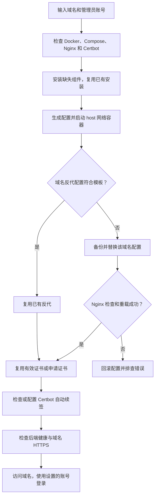

| 部署项 | 默认行为 |
| :--- | :--- |
| 部署目录 | `/opt/embyrelay` |
| 容器与反代 | 一个 EmbyRelay 容器；宿主机 Nginx + Certbot |
| 后端监听 | `127.0.0.1:6689`；仅信任 `127.0.0.1/32` |
| Nginx 配置 | 符合模板时复用；修改前备份，保留其他站点；多域名共用块需先拆分 |
| 证书 | 标准 Certbot 路径下有效证书复用；不存在或即将到期时签发 |
| 续签 | 复用定时器或 cron；续签后检查并重载 Nginx |
| 初始化密码 | 首次启动后从配置与容器中移除；数据库保存密码哈希 |

> 保持 DNS 和公网验证端口可达。域名前有 CDN 或另一层代理时，需配置可信代理链。证书签发失败时按提示检查 DNS 和端口。

**再次运行同一个脚本即可打开管理菜单**，也可以直接指定操作：

```bash
sudo bash embyrelay-install.sh install     # 安装 / 使用原配置恢复启动
sudo bash embyrelay-install.sh upgrade     # 备份后拉取最新发布镜像并更新
sudo bash embyrelay-install.sh password    # 交互修改管理员密码，不回显密码
sudo bash embyrelay-install.sh status      # 容器状态与 HTTPS 检查
sudo bash embyrelay-install.sh logs        # 最近 100 行日志
sudo bash embyrelay-install.sh uninstall   # 卸载；默认保留数据与证书
```

可追加 `--directory /你的部署目录`；后续管理必须指定相同目录。脚本每台主机管理一个固定的 `embyrelay-managed` Compose 项目，不能借助不同目录部署多个实例，也不会接管已有手动部署或 Agent 项目。

**通用一键升级（控制端与 Agent 共用）：**

```bash
curl --proto '=https' --tlsv1.2 -fsSL --retry 3 https://raw.githubusercontent.com/ecouus/EmbyRelay/main/scripts/upgrade.sh -o embyrelay-upgrade.sh && sudo bash embyrelay-upgrade.sh
```

自动识别 Compose 实例、发现最新正式镜像、备份、更新固定版本、验收并在失败时恢复旧镜像及匹配数据；不要求 GitHub Release 已创建。自定义目录用 `--directory`，指定版本用 `--version`，多实例用 `--instance PROJECT/SERVICE`。支持范围、PostgreSQL 边界与恢复命令见 [通用升级手册](docs/upgrading.md)。仓库检出环境可执行 `sudo bash scripts/upgrade.sh`。

**升级与数据保留：**

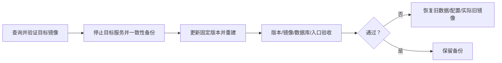

备份保存在部署目录的 `backups/`，包含数据库与主密钥。升级失败时，用备份和原镜像版本恢复。

| 管理操作 | 数据处理 |
| :--- | :--- |
| 修改管理员密码 | 撤销旧管理会话，保留两步验证 |
| 默认卸载 | 停止容器，保留数据；可通过 `install` 恢复 |
| 输入 `DELETE` 卸载 | 删除本项目数据卷与运行配置 |
| 卸载后保留 | Nginx 配置、Certbot 证书、历史备份与共用软件 |

脚本文件：[scripts/install.sh](scripts/install.sh)。首次安装中断时，使用原目录重新运行 `install`；已保存的域名和账号不会被覆盖。可查看日志排查问题。

旧版一键脚本部署的 Caddy 会停止并从 Compose 移除，原证书卷保留；新证书由 Certbot 管理。迁移期间 HTTPS 会短暂中断，失败后修复原因并重新运行 `install`。Nginx 配置备份位于部署目录的 `backups/nginx-*/`。

## 选择部署方式

| 使用场景 | 推荐入口 | 网络方式 |
| :--- | :--- | :--- |
| 新服务器一键安装 / 升级 / 卸载 | [一键脚本](#one-click) | 默认 Linux host，宿主机 Nginx + Certbot |
| 本机体验 / SSH 隧道访问 | [完整 Compose 配置](#quick-start) | 默认 bridge，端口仅绑定本机 |
| 自动申请与续期 HTTPS 证书 | [一键脚本](#one-click) | 宿主机 Nginx + Certbot |
| 已有宿主机 Nginx | [Nginx 部署](#nginx) | 可保留 bridge；Linux host 为可选方案 |
| 增加 B 服务器承担中转 | [Agent 一键部署](#agent) | host 网络，宿主机 Nginx + Certbot |

> **已有部署无需为了真实 IP 强制切换 host。** 关键是让服务只信任实际反向代理，并由反向代理正确传递客户端地址。

## 功能

- **控制台**：运行概览、源站增删改/启停/连通性检测、路由管理、可再次查看的历史访问地址、节点管理、会话、流量、审计。
- **代理**：GET / POST / WebSocket；Range / If-Range / 206 / 416；256 KiB 流式缓冲；读取超时、短读后的强 ETag 安全续拉；版本/偏移不符时断开，禁止拼接。
- **策略**：统一全程媒体中转，自动跟随 HTTP/HTTPS 跳转；回源 DNS 与实际拨号 IP 校验；显式私网 CIDR 授权。
- **订阅账号**：独立地址与登录密码、按天/按月有效期、首次登录起算、周期流量、限速、并发限制、续期及登录撤销。
- **访问控制**：管理员与只读操作员、bcrypt、登录限速、HttpOnly Cookie、CSRF 防护、Google Authenticator / 标准 TOTP、密钥撤销/轮换/有效期。
- **计量**：上下行独立累计、UTC 每日统计、单路由限速、并发上限、每日发送配额。多节点使用持久化额度预留，离线不能突破已获额度。
- **节点**：一次性注册令牌、Ed25519 签名、防重放、签名配置、AES-GCM 本地缓存、原子配置切换、心跳、流量/会话上报、离线缓存 24 小时、低连接数节点选择及离线本机回退。
- **用户自助源站管理**：管理员可在“用户自助源站”或订阅详情查看用户添加的 Emby、源站与中转地址。源站用户名和密码显示掩码，凭据加密保存；支持搜索、复制中转地址和自动刷新。
- **界面与排错**：明亮 / 暗色主题、手机端适配；播放会话和请求诊断采用简洁列表与详情抽屉，查看 IP、User-Agent、认证字段是否存在及处理建议。
- **运维**：SQLite WAL 与事务迁移、Docker Compose、Nginx + Certbot HTTPS、健康检查、Prometheus 文本指标、故障模拟器和 k6 脚本。

<a id="preview"></a>

## 控制台预览

以下截图展示当前管理控制台与用户中心，页面中的账号、源站、设备和流量均为演示数据。

<details>
<summary><strong>统一登录 · 按账号角色进入工作空间</strong></summary>

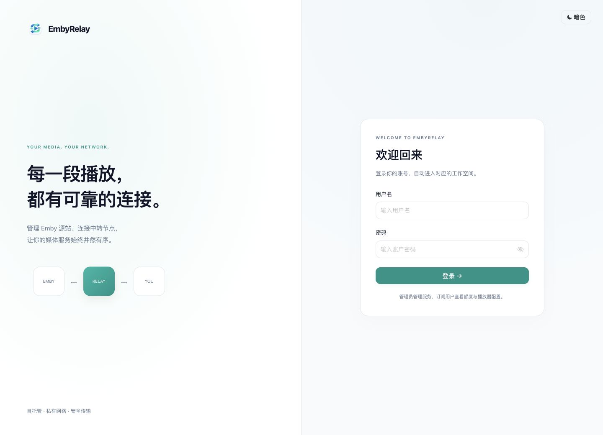

</details>

**运行概览 · 明亮主题**

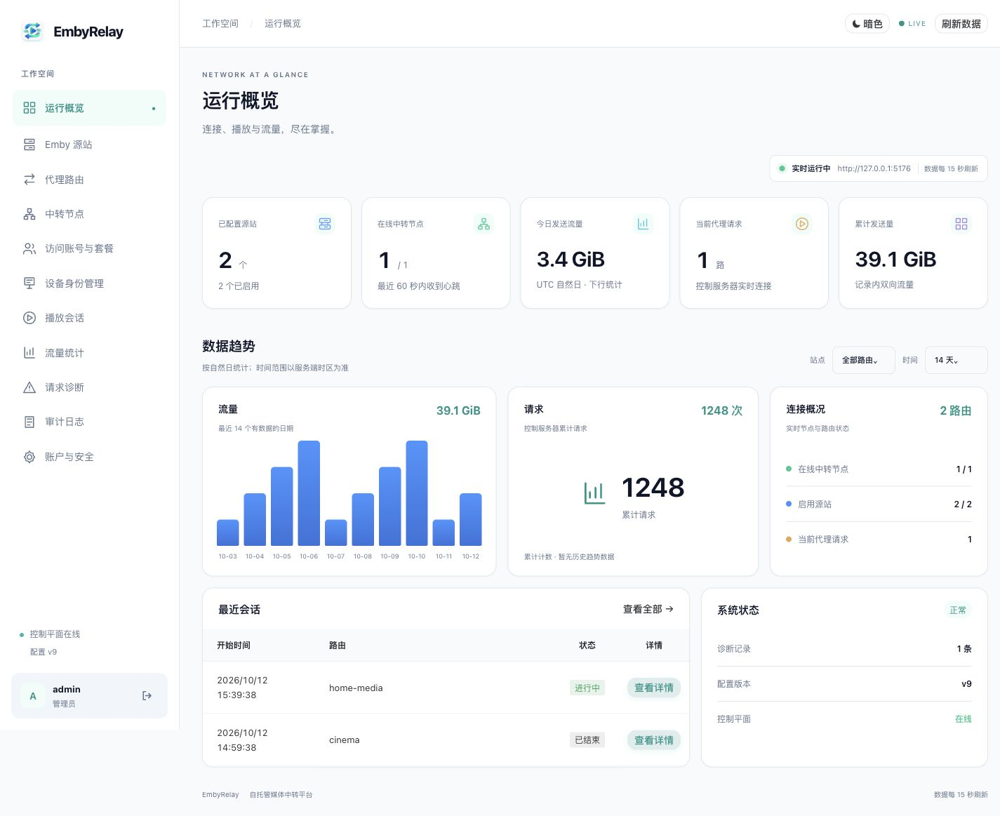

<details>
<summary>暗色主题</summary>

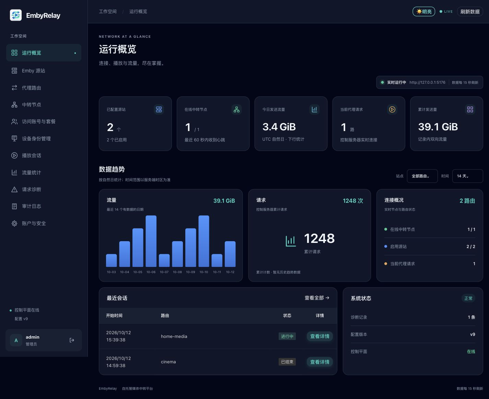

</details>

<details>
<summary><strong>Emby 源站 · 地址、状态与管理操作</strong></summary>

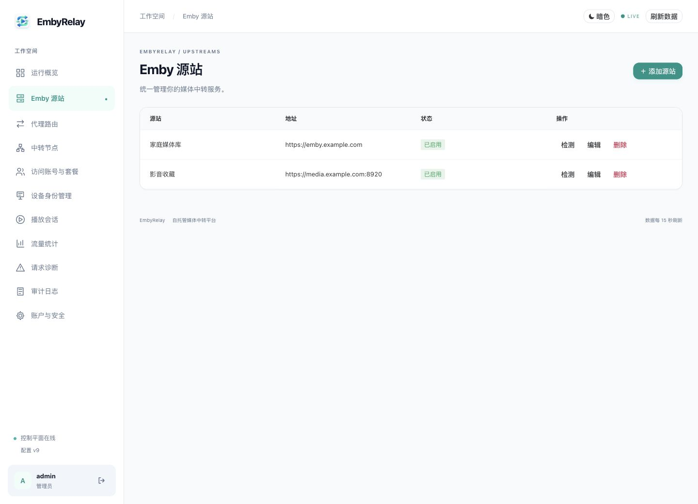

</details>

<details>
<summary><strong>播放会话 · 列表、详情与手机端</strong></summary>

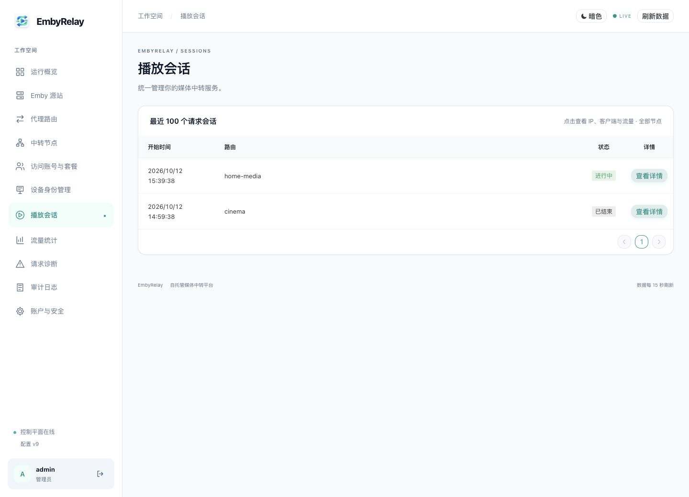

点击“查看详情”查看客户端 IP、App / 版本、User-Agent、节点和流量，长内容自动换行。

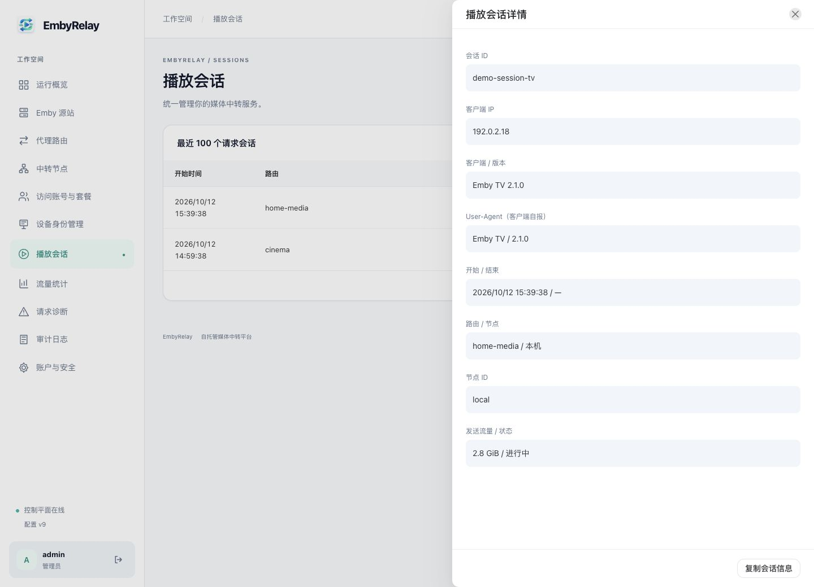

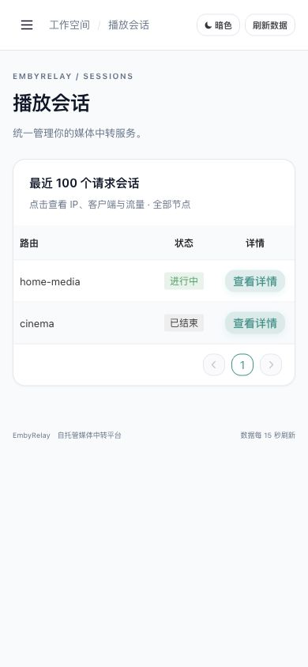

</details>

<details>
<summary><strong>请求诊断 · 对比入站与回源认证字段</strong></summary>

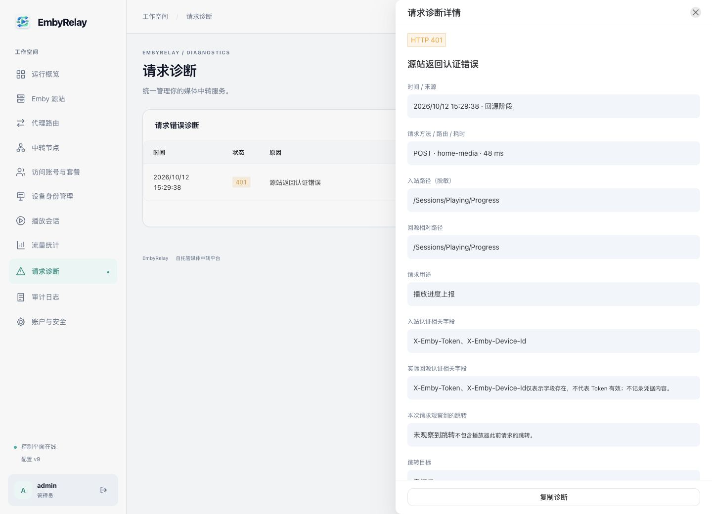

</details>

<a id="quick-start"></a>

## Docker Compose：本机体验

Debian / Ubuntu 安装 Docker Engine 和 Docker Compose 插件后，复制下面完整配置，保存为 `docker-compose.yml`。无需克隆仓库、安装 Go 或 Node.js，也无需 `.env` 文件。镜像支持 Linux AMD64 / ARM64。

首次启动前，将 `RELAY_ADMIN_PASSWORD` 改成自己的独立强密码（至少 8 字节）。

```yaml
services:
  embyrelay:
    image: ecouus/embyrelay:latest
    environment:
      RELAY_ADMIN_USER: "admin"
      RELAY_ADMIN_PASSWORD: "CHANGE-ME-before-first-start" # 首次启动前改为独立强密码
      RELAY_ALLOW_INSECURE: "true"
    volumes:
      - relay_data:/data
    ports:
      - "127.0.0.1:6689:6689"
    read_only: true
    cap_drop: [ALL]
    security_opt: [no-new-privileges:true]
    restart: unless-stopped
    stop_grace_period: 15s
volumes:
  relay_data:
```

在保存文件的目录执行：

```sh
docker compose pull
docker compose up -d
```

本机打开 [http://127.0.0.1:6689](http://127.0.0.1:6689)，使用 `admin` 和你设置的密码登录。

远程服务器可通过 SSH 隧道访问：

```sh
ssh -L 6689:127.0.0.1:6689 用户名@服务器IP
```

数据保存在 `relay_data` 命名卷中。

- `docker compose down`：停止并删除容器，保留数据卷。
- `docker compose down -v`：同时删除数据卷，数据会丢失。
- 更新版本：修改 `image`，备份后重新执行拉取和启动命令。
- 初始密码仅在首次初始化时生效。

<details>
<summary><strong>忘记管理员密码？展开离线恢复步骤</strong></summary>

`RELAY_ADMIN_USER` 和 `RELAY_ADMIN_PASSWORD` 只在首次创建账号时生效。已有数据卷时，修改 Compose 环境变量不会覆盖数据库里的账号。

还能登录时，可在“账户与安全”→“管理账户”中编辑账号并重置密码。无法登录时，使用下面的离线恢复命令，保留源站、路由和数据卷。

恢复命令要求镜像支持 `reset-password` 子命令；若运行后启动了服务器或报 usage 错误，请先检查镜像版本，不要据此认为密码已重置。

1. 将 `docker-compose.yml` 中的 `RELAY_ADMIN_PASSWORD` 改为要设置的新密码（8–72 字节）。
2. 在该文件所在目录执行，`admin` 替换为数据库中实际的管理员用户名：

```sh
docker compose pull
docker compose stop embyrelay
# 备份停止后的数据库、密钥及配置到本机目录
mkdir -p backup
docker compose cp embyrelay:/data/. ./backup/
# 使用相同数据卷，读取 Compose 中的 RELAY_ADMIN_PASSWORD 重置密码
docker compose run --rm --no-deps embyrelay reset-password admin
# 仅在看到重置成功提示后启动服务
docker compose up -d embyrelay
```

命令只修改指定的现有管理员密码，并撤销该账号的登录会话；不会更改用户名、删除配置或关闭 TOTP。开启两步验证的账号仍需输入认证器验证码。用户名错误或密码不符合要求时会报错，不会创建新账号。备份含数据库和密钥，请妥善保管。

**不要用 `docker compose down -v` 重置密码，它会删除数据卷。**

</details>

<a id="https"></a>

## 公网 HTTPS

<a id="nginx"></a>

### 宿主机 Nginx + Certbot

以下示例适用于 **Nginx 安装在宿主机、EmbyRelay 容器运行在同一台服务器**。将域名解析到服务器，开放 80/443，并提前申请域名的 TLS 证书。一键脚本会检测已有 Nginx、Certbot 和域名配置，复用正确配置，自动申请并续签证书。

**保留默认 bridge（已有部署可继续使用）**

保留快速部署中的 `ports: ["127.0.0.1:6689:6689"]`，无需添加 `network_mode`。将 `RELAY_ALLOW_INSECURE` 改为 `"false"`，再按[真实 IP 配置](#client-ip)设置 `RELAY_TRUSTED_PROXIES`。容器内服务仍监听 `0.0.0.0:6689`，宿主机 Nginx 通过发布端口访问。

`RELAY_ALLOW_INSECURE: "false"` 用于启用 Secure Cookie，并不让 EmbyRelay 自己终止 TLS；浏览器到 Nginx 使用 HTTPS，Nginx 到服务仍使用 HTTP。

<details>
<summary><strong>可选：Linux host 网络完整配置（省去 Docker 网关地址配置）</strong></summary>

仅适用于同一台 Linux 服务器上的宿主机 Nginx。选择此方案时才删除 `ports`，加入 `network_mode: host`。host 共享宿主机网络，减少了网络隔离；它不是获取真实 IP 的必要条件。

```yaml
services:
  embyrelay:
    image: ecouus/embyrelay:latest
    network_mode: host
    environment:
      RELAY_LISTEN: "127.0.0.1:6689"
      RELAY_ADMIN_USER: "admin"
      RELAY_ADMIN_PASSWORD: "替换为至少8字节的独立密码"
      RELAY_ALLOW_INSECURE: "false"
      RELAY_TRUSTED_PROXIES: "127.0.0.1/32"
    volumes:
      - relay_data:/data
    read_only: true
    cap_drop: [ALL]
    security_opt: [no-new-privileges:true]
    restart: unless-stopped
    stop_grace_period: 15s
volumes:
  relay_data:
```

完整文件也见 [`deploy/docker-compose.nginx.yml`](deploy/docker-compose.nginx.yml)。此模式适用于 Linux 宿主机 Nginx，容器共享宿主机网络，但服务只监听 `127.0.0.1:6689`，不向公网监听该端口。Nginx 始终通过回环地址连接，因此无需猜测 Docker 网关 IP。不要将监听地址改为 `0.0.0.0`。修改原部署时保持 Compose 目录、项目名和数据卷不变。

</details>

**配置 Nginx（以上两种网络方案共用）**

将以下配置保存为 `/etc/nginx/conf.d/embyrelay.conf`，替换所有 `relay.example.com` 和证书路径。该文件需在 `nginx.conf` 的 `http {}` 中加载；`map` 不能放在 `server {}` 内。

```nginx
map $http_upgrade $embyrelay_connection {
    default upgrade;
    ''      close;
}

server {
    listen 80;
    server_name relay.example.com;

    access_log off;

    # 使用 webroot 方式签发证书时，保留验证目录
    location ^~ /.well-known/acme-challenge/ {
        root /var/www/html;
    }
    location / {
        return 301 https://relay.example.com$request_uri;
    }
}

server {
    listen 443 ssl;
    server_name relay.example.com;

    ssl_certificate     /etc/letsencrypt/live/relay.example.com/fullchain.pem;
    ssl_certificate_key /etc/letsencrypt/live/relay.example.com/privkey.pem;
    ssl_protocols TLSv1.2 TLSv1.3;

    # 播放 URL 含访问密钥，不记录访问日志
    access_log off;
    add_header Referrer-Policy "no-referrer" always;
    add_header X-Content-Type-Options "nosniff" always;

    location / {
        # 保留完整的 /r/... 播放路径
        proxy_pass http://127.0.0.1:6689;
        proxy_http_version 1.1;

        # 保留端口，确保后台同源校验正确
        proxy_set_header Host              $http_host;
        proxy_set_header X-Real-IP         $remote_addr;
        proxy_set_header X-Forwarded-For   $remote_addr;
        proxy_set_header X-Forwarded-Proto $scheme;

        # WebSocket
        proxy_set_header Upgrade    $http_upgrade;
        proxy_set_header Connection $embyrelay_connection;

        # 流式转发，不缓存视频响应
        proxy_buffering off;
        proxy_request_buffering off;
        proxy_cache off;

        proxy_connect_timeout 10s;
        proxy_read_timeout 3600s;
        proxy_send_timeout 3600s;
    }
}
```

在 Compose 文件所在目录执行：

```sh
docker compose pull
docker compose up -d
curl -f http://127.0.0.1:6689/healthz
sudo nginx -t && sudo systemctl reload nginx
```

此示例假定客户端直接连接 Nginx，因此用 `$remote_addr` 覆盖 `X-Forwarded-For`，不沿用客户端自行提交的地址。如果前面还有 CDN 或其他代理，应先配置可信代理链，不能直接照搬这一假设。

然后访问 `https://relay.example.com` 登录。Range / If-Range 请求头默认透传，无需额外设置。读写超时是两次操作之间的等待时间，不是视频总播放时长。错误日志仍可能含请求 URL，应限制其访问权限。

以上配置不适用于容器内 Nginx。容器反代需要单独设计网络、服务监听地址和可信代理；容器中的 `127.0.0.1` 不指向宿主机。项目部署脚本使用宿主机 Nginx。

<a id="device-identity"></a>

### 设备身份管理

管理员在侧边栏进入 **设备身份管理**，选择 Emby 源站，再选择“源站默认”或一个已关联的访问账号。用于调整通过访问账号登录时向源站发送的设备身份，普通 Emby 账号直连的路由不应用这些规则。用户中心的“我的设备”可查看本人设备与登录映射。

<details>
<summary>查看设备身份管理页面</summary>

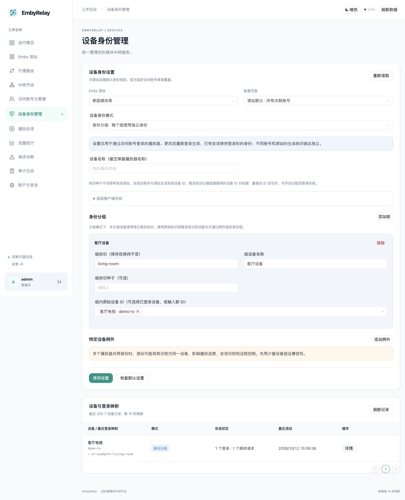

</details>

| 模式 | 行为 |
| --- | --- |
| 兼容默认 | 保留原有 Relay 登录方式：按访问账号和客户端标识生成登录身份 |
| 原始标识 | 保留播放器提交的设备 ID、设备名称和客户端信息；缺失字段使用兼容值 |
| 稳定标识 | 按账号、源站和原始设备 ID 生成稳定身份，保留真实客户端信息 |
| 自定义标识 | 同一账号在此源站的设备使用一个固定身份，可设置名称和标识种子 |
| 身份分组 | 组内设备使用一个身份，不同组彼此独立，未分组设备使用稳定标识 |

身份规则在播放器**新登录时**确定，已有 Token 保留登录时的映射。

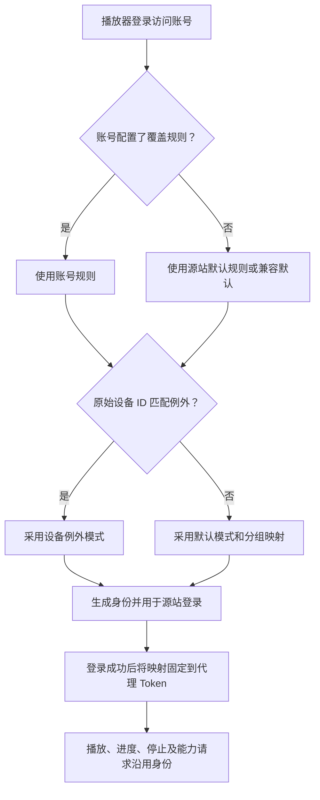

| 配置项 | 规则 |
| :--- | :--- |
| 设备例外 | 原始 ID 精确匹配，优先于默认模式 |
| 身份组 | 最多 32 组，每组 128 个设备；一个设备只能加入一个组 |
| 例外数量 | 最多 128 条 |
| 账号覆盖 | 完整替换源站规则；恢复源站默认可移除覆盖 |
| 源站恢复默认 | 恢复兼容默认；保留真实播放器身份请选择原始标识 |
| 名称与客户端字段 | 可自定义名称；客户端名称和版本留空保留真实值 |
| 标识种子 | 与账号、源站共同生成实际 ID；同一种子不会跨账号或源站混用 |
| 重装或清除数据 | 原始 ID 变化后，可手动加入原身份组 |
| 缺少设备 ID | 按 User-Agent 回退，可能无法区分同型号播放器 |

仅改写设备身份字段，保留 `PlaySessionId`、编码和转码能力。不同播放器保留独立登录。多个播放器共用身份时，源站可能合并会话识别，影响进度和远程控制；使用前检查同时播放、进度上报和停止行为。

| 设备记录 | 内容 |
| :--- | :--- |
| 展示字段 | 原始与上游标识、配置来源、组、登录结果、最近请求状态和活动时间 |
| 数据留存 | 90 天无活动清理；删除源站时清理关联记录与账号覆盖 |
| 统计含义 | 活跃媒体 HTTP 请求数不等于播放器数量 |
| 信息边界 | 不含 Token 或密码；设备信息由客户端自报，不用于认证 |

控制端与 Agent 一起升级；访问账号地址只分配给声明设备身份支持的节点。数据库当前使用迁移 v12，升级前备份数据库与 `master.key`，回退时恢复配套备份。旧 Token 重新登录后生成完整映射记录。

<a id="diagnostics"></a>

## 请求诊断与账户安全

### 自动媒体中转与账号导入

源站统一全程中转，自动跟随媒体 HTTP/HTTPS 跳转（包括 HTTPS→HTTP），无需确认 CDN 域名。旧版 Proxy / Redirect / Auto 和安全模式设置不再影响新请求。保留私网 CIDR 控制、跳转次数限制和跨域认证头清理。HTTP 回源段为明文；Agent 应与控制端一起升级。

添加或编辑源站时，可选填 Emby 用户名和密码。两者使用数据目录主密钥进行 AES-GCM 加密，源站列表和 Agent 配置均不包含凭据。编辑时留空保留原值，开启“清除已保存的 Emby 账号密码”可删除。

管理员在“代理路由 → 访问地址”选择有效地址，点击“一键展示导入信息”，即可查看中转服务器地址、源站地址、用户名和密码，并复制全部信息。关闭窗口或退出登录会清除展示内容。该功能用于播放器导入，不会代替播放器自动登录 Emby。查看动作记入审计，审计中不保存凭据。

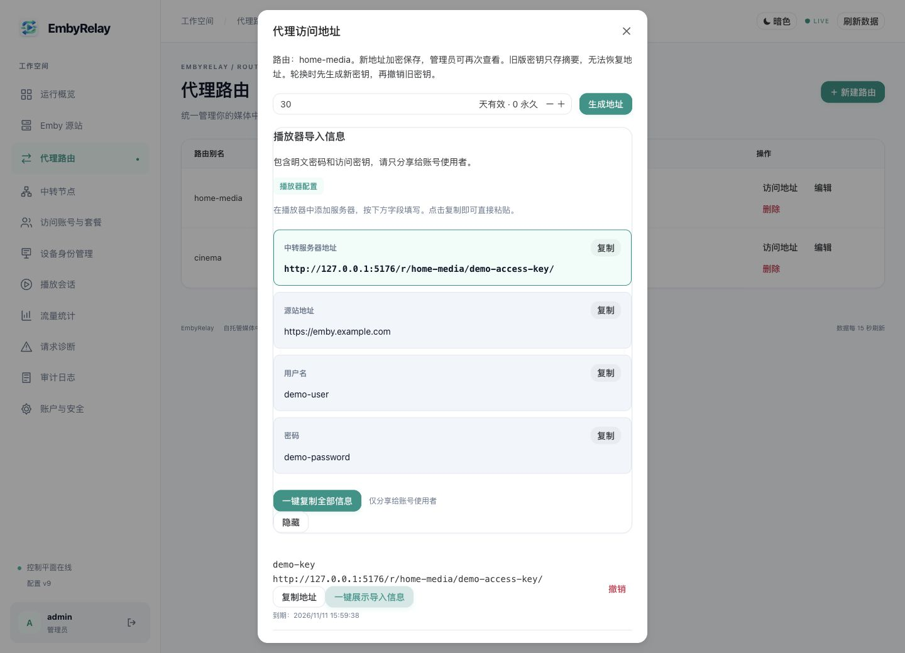

备份时必须同时保留数据库和数据目录主密钥；遗失主密钥后无法恢复已加密的密码。只向账号使用者分享导入信息。

### 独立访问账号与订阅

管理员进入“访问账号与套餐”，先创建套餐，再开通用户账号。路由默认选择“用户自行添加 Emby”；也可预先分配公共路由。

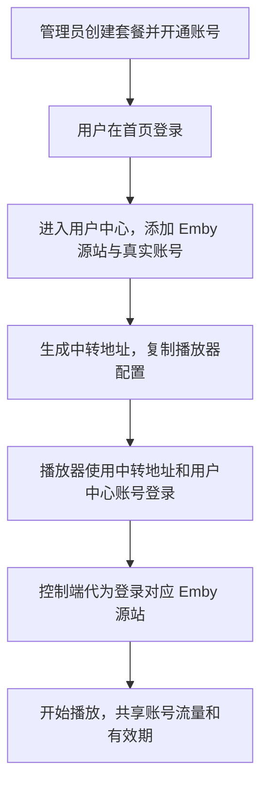

**全部源站、地址和节点共享同一账号的流量、有效期、限速与并发额度。**

| 操作方 | 可用操作 |
| :--- | :--- |
| 用户 | 添加、编辑、删除自己的 Emby；复制播放器配置；查看用量和有效期 |
| 管理员 | 创建套餐、开通账号、续期、停用、重置密码、撤销登录、重置当前流量 |
| 自助源站 | 保存前验证 Emby 服务器信息、账号登录和 Token；默认选择可用节点；单账号最多 50 个；删除或重建不清空用量和有效期 |

源站密码加密保存，列表不返回密码。首页按账号角色进入管理控制台或用户中心。

用户新增或编辑自助源站时，必须通过实际 Emby 接口与普通账号验证，失败不保存配置或生成新地址。验证请求有超时和响应大小限制，不跟随跳转；新源站仅允许公网地址，已有源站的私网访问须由管理员明确授权。验证结束后尝试注销临时会话。

用户自助中转地址仅开放列明的 Emby 播放器接口和请求方法，控制端与 Agent 均拒绝未知路径、CONNECT 和 WebSocket 协议升级。正常媒体 HTTP/HTTPS 跳转仍保留公网地址检查，以兼容 CDN 和直链播放。依赖 WebSocket 的实时通知不可用于自助地址，播放器特殊接口可能需要补充白名单。接口验证只能确认 Emby 协议行为，不能证明用户控制的服务没有伪装，也不能保证允许的媒体接口只传输影音内容。

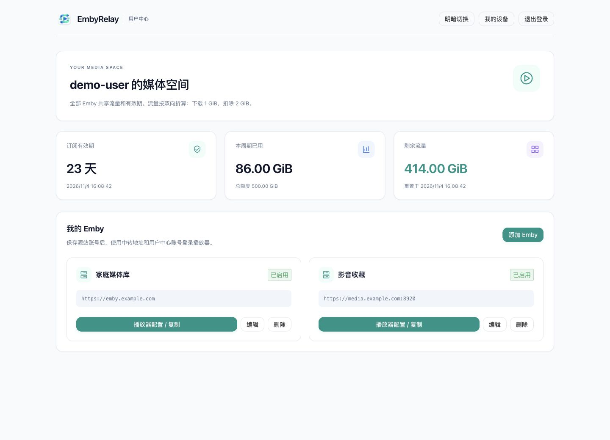

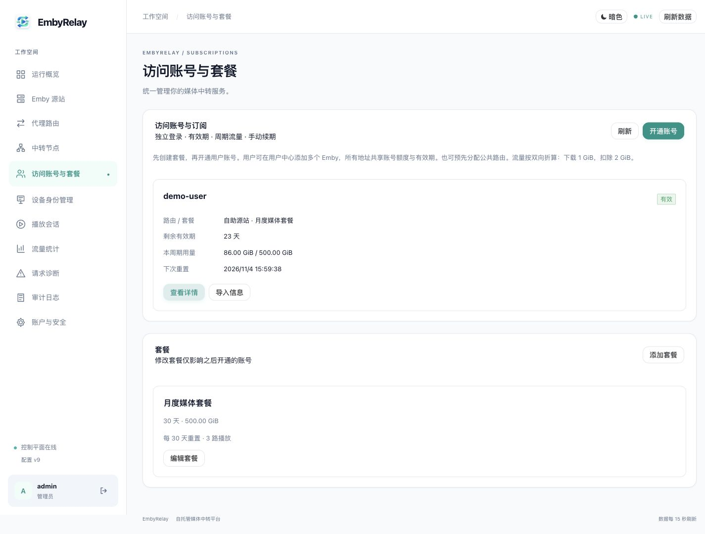

| 设置 | 规则 |
| --- | --- |
| 有效期 | 按天或按月二选一；均为 0 表示长期。月末按目标月最后一天处理 |
| 首次登录起算 | 只有播放器中转和源站两端均登录成功后才激活，登录用户中心不激活；显式固定到期时间优先 |
| 流量周期 | 累计不重置、从激活时起每 N 天，或 UTC 自然月；额度 0 表示不限 |
| 续期 | 从当前到期时间与现在中较晚者延长；不清空流量、不自动启用停用账号。未激活账号手动续期会立即起算 |
| 套餐修改 | 开通时复制套餐规则，修改套餐不追溯影响已有账号 |
| 密码与登录 | 中转密码仅存哈希，不能找回；开通/重置时保存新密码。停用、改密或撤销登录会使旧代理 Token 和用户中心登录失效 |

播放授权与计量：

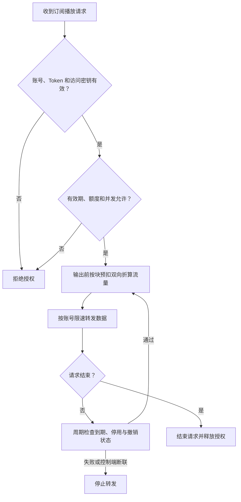

| 行为 | 规则 |
| :--- | :--- |
| 双向折算 | 实际输出字节 × 2；下载 1 GiB 扣除 2 GiB，包含鉴权 API 响应 |
| 限速 | 按实际输出字节计算 |
| 断线 | 已预扣但未送达的块仍计入用量 |
| 并发 | 统计同时进行的媒体 HTTP 请求；HLS 分片可能占用多个名额 |
| 状态检查 | 活跃请求约每 5 秒检查，停止时间还受网络超时影响 |
| 到期账号 | 可查看账户信息，停止中转和新增、编辑源站 |
| 停用账号 | 拒绝登录 |
| 共用真实 Emby 账号 | 共享观看历史、收藏和源站权限；需要隔离时使用不同真实账号 |

订阅授权与计量依赖在线控制端；控制端必须能连接源站。控制端与 Agent 一起升级，订阅地址只分配给支持授权与设备身份的节点。

媒体目标保护覆盖已识别的 JSON 地址与 HLS。订阅播放发生短读时由播放器处理恢复；账号由管理员手动开通和续期。

升级前备份数据库与 `master.key`。当前数据库版本为 v12，回退旧程序时恢复配套备份。订阅旧周期用量的留存和清理规则见 [数据库文档](docs/databases.md#订阅用量留存与清理)。

### 请求诊断

在后台“请求诊断”点击“查看详情”或“复制诊断”进行排查。

| 诊断项 | 内容 |
| :--- | :--- |
| 请求 | ID、状态码、分类、时间、入站路径和回源相对路径 |
| 回源错误 | DNS、超时、跳转策略、源站 HTTP 状态 |
| 留存 | 最多保留 1000 条，页面展示最近 100 条 |
| 脱敏 | 不记录查询参数、Cookie 和 Token 值 |
| 来源 | 控制端及 Agent 请求诊断汇总；Nginx 原始日志仍在对应服务器查看 |
| 历史记录 | 保留当时字段，不自动补齐 |

### 两步验证

在“账户与安全”配置 Google Authenticator 或标准 TOTP 认证器：


二维码在浏览器本地生成。TOTP 使用 SHA1、6 位数字和 30 秒周期；登录先验证密码，再提示验证码。

### 在面板处理回源跳转错误

“请求诊断 → 查看详情”展示路由、转发前的相对路径、耗时、跳转目标 origin（仅协议、域名和端口）及处理建议。媒体跳转自动处理，无需域名审批；私网目标仍受配置的网络策略约束。

可点击“复制诊断”提供排错信息；不记录跳转完整路径、查询参数、Cookie 或 Authorization。旧诊断不会补齐新字段。入站路径和回源相对路径分开展示，便于判断客户端是否重复拼接前缀。Agent 本地请求诊断通过独立签名接口每 15 秒分批汇总到主面板，可按节点筛选。断线后补传，重试去重，每节点保留最近 1000 条；断线或错误持续过多时，超过本地保留上限的旧记录会被淘汰。控制端与 Agent 均需升级到 1.0.2 或以上。

### 播放正常但进度上报 401

从 1.0.5 起，无 Token/Cookie 的公开图片 GET/HEAD 可使用订阅入口密钥访问，但该入口必须已有未过期登录会话。每次请求仍校验账号、密钥、源站、订阅及额度并计量；回源不使用源站 Token，私有图片仍由源站拒绝。显式错误认证不会降级，列表和播放继续要求登录 Token。

从 1.0.4 起，订阅登录同时设置限定于当前订阅路径的安全会话 Cookie，供不附带 Token 的图片 GET/HEAD 请求使用。图片仍通过控制端检查会话、账号、密钥与订阅，并执行原有计量；Cookie 不会转发到源站，不能代替列表或播放接口的 Token。客户端需保存 Cookie，升级后重新登录。公共 `System/Ping` 支持登录前探测，公共信息保留客户端设备字段但移除认证 Token。

`POST /emby/Sessions/Playing/Progress` 是播放进度上报，与视频流请求独立。源站返回 401 时，诊断会标注“播放进度上报被源站拒绝”，可能影响观看进度及续播位置，并不表示视频流一定失败。

“请求诊断 → 查看详情”展示入站与实际回源的认证相关字段名称，以及本次请求观察到的跳转域名。字段存在不代表 Token 有效，Emby 认证头也可能只包含客户端信息；不保存字段值、Cookie 内容、Token 或跳转路径及查询参数。旧记录没有这些信息，需更新后重新播放。

- 入站无认证字段：检查播放器是否为进度接口携带有效 Emby 凭据。
- 入站有字段、回源缺失：检查代理跳转策略与客户端 Connection 头。
- 两端字段均存在：检查 Token 是否过期、账号授权，并用同一播放器与账号直连源站对照。面板登录不等于 Emby 用户认证。

API 跨源跳转仍会被拒绝，媒体跨源跳转会清理认证头，不会为了消除 401 而向其他域名自动附带账号凭据。

## 播放会话与客户端信息

| 页面 | 展示内容 |
| :--- | :--- |
| 会话列表 | 开始时间、路由、状态和详情入口；手机端把时间移入详情 |
| 会话详情 | 客户端 IP、User-Agent、Emby 客户端名称和版本、节点、流量 |
| 流量页 | 最近 100 个请求会话的 IP / 客户端汇总 |
| 设备身份管理 | 原始与上游设备标识，90 天无活动后清理 |

客户端信息由请求方自报，不作为认证依据。Agent 同步升级后上报对应字段；旧记录保留原字段。管理员按自己的留存要求管理数据库及备份。

<a id="client-ip"></a>

### 配置真实 IP

EmbyRelay 默认记录直接连接者的地址。只有连接来自 `RELAY_TRUSTED_PROXIES` 指定的代理时，才解析 `X-Forwarded-For`；不会自动信任所有内网地址。不同网络方式需要不同配置：

| 部署方式 | 如何获得客户端 IP |
| --- | --- |
| 宿主机 Nginx + bridge | 保留端口映射，信任服务实际看到的宿主机代理地址，通常为 Docker 网络网关 |
| Linux 宿主机 Nginx + host（可选） | 回环监听并信任 `127.0.0.1/32`，无需配置 Docker 网关 |
| 直接访问，无反代 | 不设置可信代理，直接记录连接者 IP |

Agent 一键脚本使用 Linux host 网络，宿主机 Nginx + Certbot 管理 HTTPS。更新时保留 Compose 项目名和数据卷：

```bash
sudo bash embyrelay-upgrade.sh --directory /你的Agent部署目录
```

**已有 bridge 部署：保留端口映射，配置实际代理地址**

1. 在 Compose 所在目录查询容器连接的网络及网关：

   ```sh
   docker inspect "$(docker compose ps -q embyrelay)" \
     --format '{{range $name, $net := .NetworkSettings.Networks}}{{printf "%s gateway=%s\n" $name $net.Gateway}}{{end}}'
   ```

2. 未设置信任代理时，经 Nginx 发起一次新的播放请求，在“播放会话 → 查看详情”中核对服务实际记录的连接地址。查询得到的网关是参考值，不能替代实际核对。
3. 将确认后的地址加入 Compose 的 `environment`。例如实际地址为 `172.18.0.1` 时：

   ```yaml
   RELAY_ALLOW_INSECURE: "false"
   RELAY_TRUSTED_PROXIES: "172.18.0.1/32" # 示例，必须替换成实际确认的代理地址
   ```

4. 执行 `docker compose up -d`，重新播放并检查新会话中的 IP。

`172.18.0.1` 不是通用值；`/32` 表示仅信任这个 IPv4 地址。bridge 模式不能直接照抄 host 模式的 `127.0.0.1/32`。Docker 网络重建后若网关变化，需要重新核对。保持端口仅绑定宿主机回环地址，不要把信任范围扩大为所有私网或全网。

无论选择哪种方案，修改已有部署时都应保留原目录、Compose 项目名和数据卷，不执行 `down -v`。

自定义容器网络、远程反代、CDN 不属于上述标准拓扑，需要按实际代理链配置，不能自动信任任意来源。Nginx 前有 CDN 时，应先按其官方文档配置 real_ip 模块，只信任该 CDN 的来源范围，使 `$remote_addr` 成为验证后的客户端 IP。不要用全网 CIDR 作为可信代理。

配置生效后重新播放，在“播放会话 → 查看详情”查看新记录；旧记录不会自动修正。真实 IP 指连接服务时的公网出口 IP，使用 VPN、代理或运营商 NAT 时无法获取出口背后的原始地址。

<a id="agent"></a>

## 多节点：B 服务器一键部署 Agent

在管理面板“中转节点 → 注册中转节点”复制部署命令，以 root 在 B 执行，按提示输入域名与节点名称。支持 Debian / Ubuntu，需先安装 Docker Compose v2、curl 和 Python 3。脚本使用宿主机 Nginx + Certbot；B 域名需正确解析，公网 80/443 可达。

脚本生成 `docker-compose.yml`，保留节点数据，成功注册后清除一次性令牌；检测并复用已有 Nginx、Certbot 和正确反代配置；配置不符合时备份并替换。注册成功后在代理路由中选择 B。详细步骤及交互式命令见 [Agent 部署手册](docs/deployment.md#一键部署-bdebian--ubuntu)。

<a id="development"></a>

## 从源码运行

需要 Go 1.25+、Node.js 22.12+。

```sh
npm --prefix web ci
npm --prefix web run build
export RELAY_ADMIN_USER=admin
export RELAY_ADMIN_PASSWORD='替换为至少8字节的独立随机密码'
export RELAY_ALLOW_INSECURE=true  # 仅本机 HTTP 开发
export RELAY_LISTEN=127.0.0.1:6689
make run
```

打开 [http://127.0.0.1:6689](http://127.0.0.1:6689) 登录。默认数据目录为 `./data`，首次启动自动迁移数据库并创建账户；之后环境变量不会覆盖现有密码。前端构建产物通过 Go embed 嵌入，改动前端后需重建 Go 程序。

1. 添加 Emby 源站，例如 `http://192.168.1.20:8096`。
2. 为内网源站添加精确白名单，例如 `192.168.1.20/32`。
3. 新建路由，选择源站和本机/中转节点。
4. 在“访问地址”中生成密钥，保存生成的地址（管理员可在访问地址中再次查看）。
5. 播放器服务器地址使用 `http://127.0.0.1:6689/r/home/<access_key>/`；登录凭据仍使用该 Emby 服务器自己的账户。

新访问密钥同时保存校验摘要与加密副本，管理员可查看历史地址；旧版仅存摘要的密钥无法恢复，需重新生成。加密副本依赖数据目录中的 master.key，请随数据库一起备份。密钥轮换：先生成新地址，替换客户端配置，再撤销旧密钥。

不同 Emby 客户端对服务器地址的路径前缀处理不同；需要用实际客户端验收。已实现 PlaybackInfo 等 JSON 中常见媒体 URL 字段的前缀改写，不对完整 Emby Web UI 的 HTML/脚本进行重写。

## 开发与测试

从源码构建容器时，将 `deploy/docker-compose.yml` 的 `image` 改为 `embyrelay:local`，再执行 `docker compose -f deploy/docker-compose.yml up --build -d`。

```sh
make test                  # Go race tests + vet
make build                 # 构建前端与两个可执行文件到 bin/
go run ./cmd/faultupstream # 本机 8096 的合成媒体故障源站
```

如受本机缓存权限限制，可设置：

```sh
export GOCACHE=/private/tmp/embyrelay-go-cache
export GOMODCACHE=/private/tmp/embyrelay-go-mod
```

测试命令、覆盖范围与部署检查步骤见 [测试与检查](docs/verification.md)。

## 文档

| 文档 | 内容 |
| :--- | :--- |
| [部署手册](docs/deployment.md) | 部署、备份、Agent 与故障排查 |
| [发布指南](docs/publishing.md) | 镜像构建、发布与服务器更新 |
| [架构与数据模型](docs/architecture.md) | 系统组件与数据结构 |
| [流媒体协议](docs/streaming.md) | 转发与恢复策略 |
| [安全模型](docs/security.md) | 认证、密钥与网络策略 |
| [API 文档](docs/api.md) | 管理端与 Agent 接口 |
| [测试与检查](docs/verification.md) | 测试命令、覆盖范围与部署检查 |

控制端可使用 SQLite 或 PostgreSQL 存储配置、账号、会话与流量记录；Agent 使用本地 SQLite。数据库模式选择、备份恢复及迁移见 [数据库文档](docs/databases.md)。

## 发布与预构建镜像

GitHub：[ecouus/EmbyRelay](https://github.com/ecouus/EmbyRelay)。Docker Hub 镜像名：`ecouus/embyrelay`。发布流程及服务器直接拉取方式见 [发布指南](https://github.com/ecouus/EmbyRelay/blob/main/docs/publishing.md)。镜像提供 Linux AMD64 / ARM64 架构。`latest` 对应最近一次发布；可指定版本标签固定部署版本。

### 源站地址自动补全

添加或编辑 Emby 源站时，可直接粘贴域名、IP 或完整 URL。协议和端口已填写时保留；未填写协议默认 HTTPS，未填写端口按 HTTPS 443 / HTTP 80 补全。自定义端口需要填写，系统不会猜测 8096 或 8920。

| 输入 | 保存地址 |
| --- | --- |
| emby.example.com | https://emby.example.com:443 |
| emby.example.com:8920 | https://emby.example.com:8920 |
| http://emby.example.com | http://emby.example.com:80 |
| http://192.168.1.20:8096 | http://192.168.1.20:8096 |

双向折算用于估算源站入站与用户出站成本，不是网卡级双向实测，不包含协议开销或全部重试流量，可能与厂商账单不同。普通路由上下行统计及每日发送配额仍按各自实际应用层字节记录。
