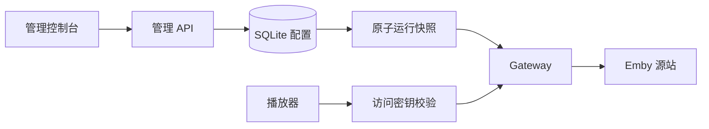
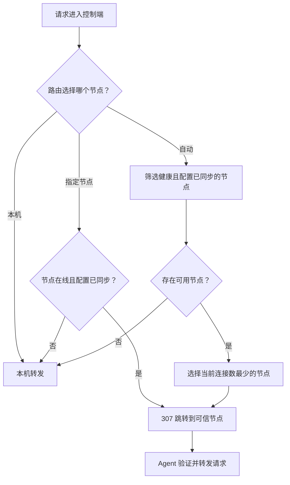

# 架构与数据模型

## 进程

`cmd/server`：控制面、管理 API、Vue 静态资源、Gateway、媒体引擎、计量和调度集成在一个进程。`cmd/agent`：只暴露健康检查与播放入口，管理路由被关闭。`cmd/faultupstream`：开发时使用的合成数据源，不是真正的 Emby 服务。

播放入口为 `/r/{alias}/{key}/...`，鉴权后移除前缀。每个路由保存独立并发和共享速率状态；配置变更替换网关，正在转发的普通请求使用原快照完成。

## 数据持久化

SQLite 使用 `database/sql` + modernc 纯 Go 驱动，WAL、busy timeout、外键和单写连接。`migrations` 中的 SQL 嵌入二进制，由事务迁移器按版本顺序应用；数据库版本高于程序支持版本时拒绝启动。内置迁移器按版本向前迁移。

SQLite 普通路径按文件名处理，路径中的 `?`、`#`、空格会自动转义。需要连接参数时使用显式 `file:` URI（例如 `file:/data/relay.db?cache=private`）；程序保留已有参数，并为每个连接设置繁忙等待和外键约束。迁移工具也支持这种 URI。

- `users`、`login_sessions`：管理身份与过期会话。
- `objects`：按 kind/id 存储结构化源站、路由、密钥、节点和节点累计上报基线；路由 alias 有唯一索引。
- `traffic_daily`：UTC 日期和路由维度的累计字节。
- `stream_sessions`、`remote_sessions`：本机与 Agent 请求会话；未收到心跳的远端活跃会话标记 unknown。
- `audit_logs`：配置、用户、安全及注册操作的行为审计。
- `settings`：配置版本、加密签名密钥与加密缓存。
- `enroll_tokens`、`nonces`：注册令牌消费与防重放。
- `quota_leases`：节点额度预留及已上报消费。
- `access_usage`、`access_rate`：访问账号的周期用量与共享限速。
- `access_tokens`、`access_leases`、`access_targets`：代理登录、播放请求授权与加密媒体目标；Token 保存登录时的设备身份与源站绑定。
- `portal_sessions`：用户中心登录会话。
- `access_devices`：设备原始身份、发送到源站的身份、最近登录和请求状态。

套餐、访问账号及账号级设备策略存储在 `objects` 中。源站设备策略作为源站配置的一部分保存。账号级策略覆盖源站默认策略，播放器新登录时解析身份并固定到 Token。

访问密钥以摘要鉴权，历史访问地址加密保存供管理员查看。源站凭据、订阅登录使用的 Emby Token 和受保护媒体目标 URL 加密保存；中转账号密码保存 bcrypt 哈希。源站地址只接受独立的地址字段，账号密码通过专用字段配置。TOTP secret 与控制端签名私钥经 AES-GCM 加密，master.key 以 0600 保存，目录默认 0700。

## 多节点

| 同步项 | 行为 |
| :--- | :--- |
| 周期 | 每 15 秒拉取配置并上报心跳、最近 100 个会话及累计流量 |
| 可用条件 | 配置版本已确认，60 秒内有心跳 |
| 配置保护 | Ed25519 签名、AES-GCM 缓存、内存原子替换 |
| 离线缓存 | 普通路由最多使用 24 小时，过期移除；订阅授权依赖在线控制端 |
| 节点身份 | 私钥文件 0600，原子写入；HTTPS 建立首次信任 |
| HTTP 开发模式 | 显式启用，并提供服务器签名公钥 pin |

调度发生在请求开始前；正在转发的响应保留原节点。

登录失败按入口和 IP 限制；同一用户名跨 IP 的失败次数超过 5 分钟 50 次后，仅对失败响应施加逐步增加的延迟（250 ms 至 2 s）。正确凭据不受用户名全局计数阻断或延迟，延迟不持有计费或限速锁，请求取消时终止等待。管理端和用户中心会话失效统一返回 `401` 与 `code: "auth_expired"`，前端不依赖错误文案。

## 流量、限速和配额

源站响应体读取计为 ingress，成功写出至客户端的响应体计为 egress，不包含 HTTP/TLS/IP 开销。JSON 改写可能使两者不同。媒体跳转由中转服务继续回源并计量。WebSocket 计量其双向转发数据，不保证包含握手头。

路由带宽限制按服务节点执行，同一节点内该路由的请求共享发送速率。普通 API 每次最多 32 KiB 预扣；视频流按 10 MiB 批量预扣，使用最多 256 KiB 的写出块，剩余额度不足时缩小预扣批次。心跳统计排除未发送的在途额度，正常结束会退还剩余预扣。进程异常退出且未完成结算时，每路流最多保守多算 10 MiB；小配额、多并发场景可能提前用尽额度。这是减少数据库写入、保证配额不被并发超用的取舍。数据库故障时停止传输，不能无计量继续放行。

视频写出后的在途额度消费只持有独立内存锁，不等待数据库计费锁。预扣、退款和统计读取仍按数据库锁再内存锁的顺序保持数据库与预扣偏移一致；统计查询不会在访问数据库时持有内存锁。

入站统计合并到下一次出站预留事务，响应结束时补写剩余入站；会话进度最多每秒落库一次，结束时记录最终值。进程异常退出可能丢失尚未落库的入站统计或最近会话进度。控制端可选 SQLite 或 PostgreSQL，Agent 保留本地 SQLite；当前仍按单控制端部署，详见 [数据库部署](databases.md)。

分布式配额：控制端按 route/day/node 预留最多 32 MiB 一批的额度；重试以累计目标额度幂等。节点使用额度之前将授予值持久化，本机累计发送不可超过授予值。控制端计算可用配额时同时扣除已计量流量和节点尚未上报消费的预留额度。因此节点失联时，备用节点不能重复花费同一份预算。预留额度不能在当天强行回收，可能造成配额暂时未用满；UTC 次日重新分配。

配置修改影响新请求；降低配额或撤销密钥不会追溯取消已开始的请求。离线 Agent 的撤销延迟最长受 24 小时缓存策略限制。

### 中转诊断汇总

Agent 使用 `/api/v1/agent/diagnostics` 独立签名上传失败请求及结构化同步错误，每批最多 100 条，每 15 秒尝试上传。该接口与心跳独立，心跳返回 400 时仍可上传诊断。控制端以签名节点身份写入来源，使用节点 ID 与原请求 ID 去重；只有控制端确认的记录才在 Agent 标记已上传。重启后读取数据库继续补传。控制端和每个 Agent 按节点保留最近 1000 条，超出上限的历史记录会淘汰。原始请求 ID 可从汇总 ID 的节点前缀后取得。Nginx 原始日志不由应用采集。
