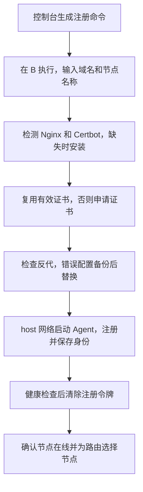
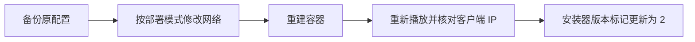

# 部署与运维

## 环境变量

| 变量 | 默认 / 用途 |
|---|---|
| RELAY_LISTEN | server: 127.0.0.1:8080；agent: 127.0.0.1:8081；容器: 0.0.0.0:6689 |
| RELAY_DATA_DIR | server: data；agent: agent-data；容器: /data |
| RELAY_ADMIN_USER | 首次启动 admin |
| RELAY_ADMIN_PASSWORD | 首次启动必须设置，至少 8 字节，最多 72 字节 |
| RELAY_MASTER_KEY | 可选，32 随机字节的无 padding Base64；未设置则生成 data/master.key |
| RELAY_ALLOW_INSECURE | 默认 false。true 仅用于本机/可信隔离网络的 HTTP 测试 |
| RELAY_TLS_CERT / RELAY_TLS_KEY | 可选，Go 服务直接提供 HTTPS；也可由 Nginx 终止 TLS |
| RELAY_CONTROL_URL | Agent 的 HTTPS 控制服务器 origin |
| RELAY_PUBLIC_URL | Agent 对外 HTTPS origin |
| RELAY_NODE_NAME | Agent 注册时显示的名称 |
| RELAY_ENROLL_TOKEN | 首次注册的一次性令牌，重启后使用持久身份 |
| RELAY_SERVER_KEY | 服务器签名公钥 pin；HTTP 开发模式首次注册必须提供 |

## 单机 Docker

使用 README 的 Compose 指令。默认数据命名卷保留 SQLite、master.key、会话、审计和配置。所有部署参数直接写在 YAML 中，无需 `.env`。首次启动前替换默认管理员密码；初始化后修改该值不会重置既有密码。

容器为非 root 用户、只读根文件系统，仅 /data 可写。容器内回环不是宿主机回环，Emby 地址使用实际可达内网地址或容器网络 DNS，并按解析 IP 配置授权 CIDR。通过 EasyTier 时也要显式授权对应虚拟地址。

| HTTPS 方式 | 网络与更新 |
| :--- | :--- |
| 宿主机 Nginx | 使用 `deploy/docker-compose.nginx.yml`，host 网络、后端仅监听并信任回环 |
| Nginx 配置文件 | 独立使用，不与基础 Compose 叠加 |
| 管理与播放入口 | 默认共享域名；前置反代可按路径设置访问控制 |
| 流式响应 | 保持关闭整响应缓冲，避免设置视频总播放时长超时 |

## Agent 节点

### 一键部署 B（Debian / Ubuntu）

先在 B 安装并启动 Docker Engine、Compose v2，以及 `curl` 和 `python3`。Docker 安装参考 [Debian](https://docs.docker.com/engine/install/debian/) / [Ubuntu](https://docs.docker.com/engine/install/ubuntu/)。A 必须有可访问的 HTTPS 地址；将 B 的域名解析到 B，B 需能访问 A 与 Emby 源站。

在 A 的“中转节点 → 注册中转节点”复制安装命令，以 root 在 B 执行：



| 方式 | 前提与配置 |
| :--- | :--- |
| Nginx + Certbot | 监听 `127.0.0.1:6689`，信任回环；自动检查反代、申请证书并配置续签 |
| 公共配置 | 默认 `/opt/embyrelay-agent`，镜像 `ecouus/embyrelay:latest` |

也可以在 B 交互式运行（不必把令牌放入命令历史）：

```bash
curl -fsSL https://raw.githubusercontent.com/ecouus/EmbyRelay/main/scripts/install-agent.sh -o install-agent.sh
sudo bash install-agent.sh
```

此方式在配置 HTTPS 及拉取镜像后才询问注册令牌，届时在 A 生成即可。令牌十分钟有效，仅使用一次。面板命令内含令牌，不要转发；如首次下载耗时导致过期，在 A 重新生成令牌，再执行新命令。

脚本检测到已有部署时保留配置、命名卷和节点身份，检查 HTTPS 反代并更新镜像；新命令中的域名、节点名称与模式不会覆盖已有部署。未成功注册且配置仍保存令牌时，允许用 `--token` 替换过期令牌重试。不覆盖非本脚本生成的 Compose 文件。配置采用 JSON 形式的合法 YAML，所有参数保存在 `docker-compose.yml` 内，不使用 `.env`，文件权限为 0600。

Agent 本机健康检查成功后，脚本清空配置中的令牌并重建 Agent，移除容器环境中的令牌。注册身份保存在数据卷中。**不要删除数据卷或执行 `down -v`**。本机健康检查不代表公网 HTTPS 已就绪：仍需确认 DNS、证书、防火墙，回 A 确认节点在线，并在代理路由中选择 B。

查看日志、更新：

```bash
cd /opt/embyrelay-agent
docker compose logs --tail=100 -f
# 更新时保留原配置和数据
docker compose pull
docker compose up -d --force-recreate
```

重复运行脚本也可更新。自定义部署目录使用 `--directory /你的路径`，之后重跑保持同一路径。只在 B 部署一套 Agent，默认 Compose 项目名固定为 `embyrelay-agent`。

### 手动部署

1. 控制台“中转节点”生成注册令牌，复制公钥。
2. 在另一台 Linux 服务器复制项目，编辑 `deploy/compose.agent.yml` 中的控制端地址、节点域名、名称、令牌和签名公钥。
3. 按 [README 的 Nginx 配置](../README.md#nginx) 为节点域名配置 HTTPS，使用 Certbot 申请证书并启用续签，再启动 Agent：

```sh
docker compose -f deploy/compose.agent.yml pull
docker compose -f deploy/compose.agent.yml up -d --no-build
```

4. 节点第一次注册后保留 agent_data 卷，清空 YAML 中的注册令牌。
5. 在路由中选择节点或自动选择，等待配置同步及心跳（约 15 秒）。

HTTP 隔离环境可使用直接运行 agent 的方式，显式设置 `RELAY_ALLOW_INSECURE=true` 和公钥 pin；生产不要使用此模式。

节点离线后 60 秒内调度器停止分配新请求并回退本机，因此控制服务器也必须能够到达源站。已播放响应不会在不同节点间无校验切换。Agent 最多离线运行 24 小时，之后配置失效；每日配额路由还受已预留额度限制。

## 备份与恢复


| 备份内容 | 用途 |
| :--- | :--- |
| SQLite 数据库及 WAL 状态 | 配置、账号、会话与用量 |
| `master.key` | 解密保存的凭据、Token 和配置 |
| Agent `identity.json` | 节点身份与签名 |

在线备份使用 SQLite backup API 或 VACUUM INTO；不要只复制运行中的主数据库文件。

恢复到同一服务角色时保留数据目录及主密钥。不要把同一个 Agent 身份/数据库复制到两台同时运行的节点；重复身份破坏额度与累计计量语义。恢复旧 Agent 流量库可能触发控制端“counters cannot decrease”，需停止旧节点、取消路由分配后重新注册新节点。

更新前备份；迁移自动执行。不能直接用旧二进制打开更新后的数据库。master.key 遗失会使加密信息无法恢复；初始化账户密码变量不会重置既有账户，可由其他管理员在 UI 重置。

## 指标与排错

- `/healthz`：进程/数据库可用性，不代表每个源站健康。
- 源站“检测”：通过实际网络策略请求 System/Info/Public，显示状态和耗时。
- `/metrics`：需有效管理会话 Cookie，暴露请求计数、活跃请求及 route/day 流量。对 Prometheus 使用独立只读账户登录后提供 Cookie，会话有效期为 12 小时，采集端需要定期重新登录。
- 401 播放：检查路由密钥是否过期/撤销；Emby 返回的认证失败还需检查 Emby Token。
- 502：检查源站 URL、CIDR、DNS 和跳转目标的连通性；不会在响应中泄露带 Token 的地址。
- 429：每日配额已耗尽；已预留给离线 Agent 的额度当天不回收。
- 503：路由达到并发上限，或计量数据库不可用。
- Agent 签名失败：检查服务器时间同步，timestamp 容许偏差两分钟。
- 节点在线但不分配：等待配置版本追上控制端；检查路由是否启用且已分配。

停止服务时会先停止接收新连接，最多等待十秒后关闭正常 HTTP 连接；客户端应自行重连。

### 旧版 Agent 安装脚本配置迁移

迁移 `x-embyrelay-installer.version: 1` 配置时，先备份文件，保留原目录、项目名和数据卷。

| 模式 | 配置变更 |
| :--- | :--- |
| Nginx | 删除 Agent 的 `ports`，添加 `network_mode: host` |
| Nginx 监听 | `RELAY_LISTEN: "127.0.0.1:6689"`，反代使用 README 的转发头配置 |
| 可信代理 | Agent 设置 `RELAY_TRUSTED_PROXIES: "127.0.0.1/32"` |



重建使用 `docker compose up -d --force-recreate`。配置保留 JSON 格式，完成对应迁移后继续使用脚本更新。

### 旧版容器反代 Agent 迁移

脚本检测到旧版容器反代配置时会停止，避免直接改写正在运行的部署。先备份部署目录并记录 Compose 项目名和数据卷；停止旧反代容器释放 80/443（不要执行 `down -v`），将其服务从 Compose 移除，保留数据卷。Agent 设置 `network_mode: host`，删除 `ports`，监听并信任 `127.0.0.1`；安装宿主机 Nginx + Certbot，按 README 模板配置节点域名。验证 HTTPS 与节点在线后，再使用 Docker Compose 更新。对本脚本生成的 JSON 配置，将 `x-embyrelay-installer` 更新为 `version: 2`、`mode: nginx`，之后可重新运行脚本自动检查反代与续签。迁移期间入口会短暂中断。
