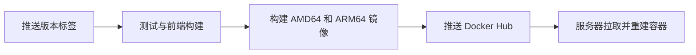

# GitHub 与 Docker Hub 发布

代码仓库：https://github.com/ecouus/EmbyRelay
镜像仓库：https://hub.docker.com/r/ecouus/embyrelay

Docker 仓库名称必须小写。支持 linux/amd64（常见 Debian/Ubuntu VPS）和 linux/arm64。

## 一次性设置

在 GitHub 仓库 Settings → Secrets and variables → Actions 添加：

- `DOCKERHUB_USERNAME`：具有目标仓库推送权限的 Docker Hub 用户名。
- `DOCKERHUB_TOKEN`：Docker Hub 生成的访问令牌，需具备目标镜像写入权限。

令牌存入 GitHub Secrets；Docker Hub 推送目标为 `ecouus/embyrelay`。

## 发布版本

```sh
git tag v1.0.2
git push origin v1.0.2
```



正式标签 `v1.0.2` 对应 `1.0.2`、`1.0`、`latest`；预发布不更新 `latest`。手动运行工作流时选择版本标签。

## Debian / Ubuntu 拉取部署

直接编辑 `deploy/docker-compose.yml` 中的镜像、管理员用户名和密码；首次启动前必须替换默认密码，无需 `.env` 文件。

```sh
docker compose -f deploy/docker-compose.yml pull
docker compose -f deploy/docker-compose.yml up -d --no-build
```

本次发布版本为 `1.0.2`，同时更新 `latest`，目标架构为 AMD64/ARM64。HTTPS 和 Agent 使用同一镜像，参照 deployment.md 的配置文件。

## 本机手动推送（可选）

```sh
# 已登录 Docker Hub 时无需重复 docker login
docker buildx build --platform linux/amd64,linux/arm64 \
  -f deploy/Dockerfile \
  -t ecouus/embyrelay:1.0.2 -t ecouus/embyrelay:1.0 -t ecouus/embyrelay:latest --push .
```

源代码仓库不包含数据库、master.key、Agent 身份、.env、node_modules、本机构建二进制或临时验收截图（README 展示图片保存在 docs/ 并随仓库提交）。前端 dist 在 CI/Docker 构建时生成。

## 1.0.2 变更

- 中转节点通过独立签名接口同步请求诊断，失败时本地保留，确认后标记上传，重试不重复入库。
- 控制端请求诊断可按节点筛选，展示节点名称、脱敏路径、回源信息和 Agent 配置/心跳同步错误。
- 每节点保留最近 1000 条，单批最多 100 条，正常每 15 秒上传；仅上传失败请求与结构化同步错误，不采集 Nginx 原始日志。
- 数据库升级至 v10，SQLite/PostgreSQL 及离线复制工具同步支持。先升级控制端，再升级 Agent；旧版控制端无法接收诊断，Agent 保留本地记录等待控制端升级。

## 1.0.1 变更

- 修复播放器拼接地址产生 `//emby/Users/AuthenticateByName` 时，订阅登录被误判为缺少 Token。
- 兼容 `/Emby/` 大小写前缀；保留媒体路径内部斜杠与编码。
- 修复控制端与 Agent 安装脚本的终端交互输入。
- 增加登录、代理 Token、播放及匿名访问拒绝的回归测试。

## 1.0.0 变更

- 控制端支持 SQLite 和 PostgreSQL，一键安装可选择独立 PostgreSQL 容器；已有安装保持原数据库类型。
- 新增数据库适配和 PostgreSQL 迁移，提供备份恢复、SQLite → PostgreSQL 一键切换及迁移中断重试。
- 镜像包含离线数据库复制工具，Agent 继续使用本地 SQLite。
- 入站统计合并到出站计量事务，会话进度最多每秒更新一次；严格额度仍在发送前验证。
- 健康接口报告数据库类型及统一的软件版本，CI 增加 PostgreSQL 行为和跨数据库复制测试。

新版本仍支持单个控制端实例。使用 PostgreSQL 的维护与迁移步骤参见 [数据库部署文档](databases.md)。

### 设备身份管理功能

- 新增设备身份管理：管理员可配置源站默认和账号覆盖、身份组及设备例外；用户可查看自己的设备记录。
- 播放器登录时固定设备身份，后续播放与进度请求沿用同一身份；策略更改对新登录生效。
- 优化后台及用户中心界面，补充设备相关 API、数据迁移和兼容说明。

升级前备份数据库与 master.key。本版迁移数据库至 v9；回退需恢复配套旧备份。控制端和 Agent 应一起升级。设备身份配置不能改变源站的授权或并发规则。
