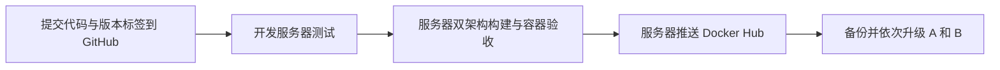

# GitHub 与 Docker Hub 发布

代码仓库：https://github.com/ecouus/EmbyRelay
镜像仓库：https://hub.docker.com/r/ecouus/embyrelay

Docker 仓库名称必须小写。支持 linux/amd64（常见 Debian/Ubuntu VPS）和 linux/arm64。

## 默认发布：开发服务器

镜像由开发服务器构建并直接推送 Docker Hub；推送 GitHub 版本标签不再自动构建或发布镜像。GitHub main / PR 仍运行代码验证，容器启动验收移到服务器发布脚本。GitHub 手动发布工作流保留作为备用入口。

开发服务器需要 Go 1.25.x、兼容项目的 Node.js/npm、Python 3、Git、Docker Engine、Compose 和 Buildx，以及对 `ecouus/embyrelay` 有推送权限的 Docker Hub 登录。持久构建器 `embyrelay-builder` 保存构建层和 Go 编译缓存，不要在每次发布后清理它。服务器默认使用支持多架构加载的 Docker containerd 镜像存储；旧版 Docker 如不支持需先升级。

```sh
# 在开发服务器执行；Password 提示输入 Read & Write 的 Docker Hub Token
# 凭据不会随 Git 仓库同步
docker login --username ecouus

# 完整发布前验证：SQLite/PostgreSQL、前端和双架构镜像启动；不推送
bash scripts/publish-server.sh --check

# 仅镜像构建和启动验收，用于测速；不替代发布前完整验证
bash scripts/publish-server.sh --build-only
```

## 发布新版本

先更新 `internal/version/version.go` 和发布说明，完成提交；以下 `vX.Y.Z` 必须替换为实际新版本。脚本要求工作区干净、HEAD 等于标签提交、GitHub 上对应标签已同步、源码版本一致，并拒绝覆盖已存在的版本镜像。

```sh
git push origin main
git tag vX.Y.Z
git push origin vX.Y.Z
bash scripts/publish-server.sh --publish vX.Y.Z
```

脚本先运行验证，再构建 linux/amd64 和 linux/arm64 镜像并检查本机容器健康，然后通过缓存构建推送镜像，最后显示远程 manifest。正式版本更新 `X.Y.Z`、`X.Y`、`latest`，预发布只推送完整预发布版本。验证失败不发布镜像。GitHub Release 更新描述和 A/B 生产升级仍分别执行。



## GitHub 手动发布备用入口

`.github/workflows/docker-publish.yml` 仅允许手动触发，必须选择已有版本标签。备用方式需要仓库 Actions Secrets：`DOCKERHUB_USERNAME`、`DOCKERHUB_TOKEN`。同一版本只选择一条发布路径，不要同时执行服务器发布和 GitHub 备用发布。

## Debian / Ubuntu 拉取部署

直接编辑 `deploy/docker-compose.yml` 中的镜像、管理员用户名和密码；首次启动前必须替换默认密码，无需 `.env` 文件。

```sh
docker compose -f deploy/docker-compose.yml pull
docker compose -f deploy/docker-compose.yml up -d --no-build
```

当前已发布版本为 `1.0.20`，`latest` 指向该版本，目标架构为 AMD64/ARM64。HTTPS 和 Agent 使用同一镜像，参照 deployment.md 的配置文件。

## 构建上下文

源代码仓库不包含数据库、master.key、Agent 身份、.env、node_modules、本机构建二进制或临时验收截图（README 展示图片保存在 docs/ 并随仓库提交）。前端 dist 在验证/Docker 构建时生成；本地交接文档 CLAUDE.md 同时被 Git 和 Docker 构建上下文忽略。

## 1.0.20 更新

- 登录自动识别身份，管理与订阅账号用户名全局唯一（忽略大小写）。数据库迁移 15 对历史重名拒绝升级，需先更名后重试，避免静默改变账号。
- 概览累计消耗量、今日消耗流量和柱状图统计源站接收加客户端发送；套餐计费不变。
- 登录、管理与订阅页面全局页脚增加 GitHub 仓库入口。


## 1.0.19 变更

- 播放代理响应使用严格 sandbox CSP，隔离用户源站返回的 HTML/SVG，防止获得管理界面的同源权限。
- 升级失败时以升级前实际容器镜像 ID 重建服务，禁止重新拉取，并验证恢复后的镜像及版本；HTTPS 验证失败也会回滚。
- Agent 心跳支持整个 365 天流量保留期内的历史补报；超出保留期的记录不再阻断心跳。
- Agent 根据有效配置内容同步，同版本内容变化、离线缓存过期后的重连均会重新应用；能力握手后等待下一轮配置同步再参与分流。
- 订阅流量批量授权与限速分离，按小块实际输出共享速率预算，取消等待不会累计未来速率债务。
- 数据库 v14 持久化路由未发送额度，异常退出后自动退款，并保留已提交的实际发送计量；SQLite/PostgreSQL 与离线复制工具同步支持。
- 登录页支持明确选择订阅用户中心，导出的用户中心链接自动选择订阅身份，兼容存量同名账号。
- 增加 HTML/SVG 隔离、历史心跳、同版本重连、限速取消重试、进程强杀恢复和安装回滚回归测试。

升级前备份数据库和 master.key；先升级控制端，再升级全部 Agent。限速优化需双方均升级。回退需恢复配套旧数据库备份。异常退出瞬间已写入网络但尚未提交计量的最后一个输出块无法与网络原子提交，可能少计；未发送的整块预扣不会被计为实际流量。旧版已遗留的预扣没有可恢复的明细，本次迁移不会猜测或改写历史计量。

## 1.0.18 变更

- 视频发送后的在途额度消费使用独立内存锁，不再等待计费数据库事务；保留预扣、退款和统计的一致性。
- 同一用户名跨 IP 的失败计数超过 5 分钟 50 次后逐步延迟失败响应，最多 2 秒；正确凭据不受全局失败计数阻断或延迟。
- 管理端及用户中心会话失效返回固定 auth_expired 错误码，前端不再依赖错误文案。
- 增加并发计量、锁隔离、限速和认证错误码回归测试；无数据库迁移，先升级控制端再升级 Agent。

## 1.0.17 变更

- 修复 operator 自身密码与两步验证接口的权限拦截。
- 登录失败限速使用 IP 和用户名与 IP 组合，避免跨 IP 定向锁定账户。
- SQLite 路径正确转义并保留 URI 参数，离线迁移支持文件 URI。
- 订阅短写退款在下一批计费前按原周期结算，保留退款上限与事务回滚保护。
- 前端子页面统一处理会话过期，错误的当前密码不会注销有效会话；CI 增加前端回归测试。
- 无数据库迁移，先升级控制端再升级 Agent。

## 1.0.16 变更

- 心跳流量排除播放流尚未使用的预扣额度，保留 10 MiB 批量计量；正常退款不再造成累计流量回退。
- 新版 Agent 首次实际流量心跳校正旧上报值，后续仍限制异常回退；禁止退回旧计量模式。
- 预扣退款归还原 UTC 日期，避免跨午夜退错日期；心跳拒绝诊断记录具体原因。
- 无新数据库迁移，先升级控制端再升级 Agent。升级到新版心跳模式后，回退旧 Agent 需恢复配套控制端备份。

## 1.0.15 变更

- 删除路由时同步解除账号绑定并撤销该路由登录会话；保留套餐、有效期和用量。
- 数据库 v13 清理历史已删除路由的遗留绑定；账号页显示用户源站数量。
- 管理员订阅导入地址使用与用户中心相同的节点入口选择逻辑。
- 升级前备份；回退需要恢复配套数据库备份。

## 1.0.14 变更

- 源站管理分为管理员源站与用户源站，按所属账号分别展示，避免列表重叠。
- 概览保留全部源站总数，并展示管理员、用户和已启用数量。
- 无数据库迁移。

## 1.0.13 变更

- 修复源站编辑按钮无响应：兼容后端返回空值的私网白名单和重定向主机列表。
- 无数据库迁移，控制端与 Agent 统一更新至 1.0.13。

## 1.0.12 变更

- 等待优雅关闭完成后退出并关闭 WebSocket；登录失败限速按可信代理识别的 IP、用户名和入口分别计数，IPv6 正常识别。
- 诊断记录使用有界队列批量写入，401/404 抽样，清理放入维护任务；配置版本不变时 Agent 不再重建转发器，心跳不覆盖节点停用状态。
- 普通视频使用 10 MiB 计量预扣并退还未发送额度；复用媒体转发器，订阅静态视频支持续传，上游响应头超时调整为 45 秒。
- Agent 配额申请按路由加锁、增加申请量与控制端连接复用；保留 1.0.11 的 Agent 出站退款修正。
- 支持删除账号和未使用套餐、批量账号操作、账号分页搜索与套餐应用；operator 可管理自身密码和两步验证，验证码不可重放。
- 数据库迁移 v11/v12 增加索引与用户名唯一约束、TOTP 重放保护、旧周期留存和实际预扣周期退款；移除废弃 relay_reports，离线复制保留新增字段。
- 合并侧边菜单、移除重复页面标题、调整留白；统一前端请求错误处理，隐藏标签页暂停轮询，按当前页刷新并恢复导航位置。
- 安装器支持镜像覆盖、升级失败恢复镜像及备份、自动备份保留 5 份；健康检查适配监听端口，CI 增加镜像启动验证。

升级前备份数据库和主密钥；先升级控制端，再升级 Agent。升级后的数据库不能直接由旧程序打开，回退需恢复配套备份。新用户名唯一索引要求先解决已有大小写重复的账号名称。周期留存规则见 [数据库文档](databases.md#订阅用量留存与清理)。

本版不包含前端按页面拆分、Agent 后台提前续租和完整容量压测。

## 1.0.5 变更

- 兼容不发送 Token 或 Cookie 的公开图片 GET/HEAD 请求：使用订阅入口密钥，并要求同一账号、密钥、源站已有未过期登录会话。
- 公开图片仍通过控制端检查账号、密钥、订阅与额度，执行原有租约、流量计量和限速；退出或撤销最后有效会话后拒绝访问。
- 不为公开图片回源注入源站 Token，不借用其他设备凭据；源站拒绝的私有图片仍保持拒绝。显式错误认证不会降级到公开图片模式。
- 仅允许白名单图片路径，列表、播放、修改、媒体跳转及 RPC 其他操作不能使用公开图片授权。控制端与 Agent 均需升级，无数据库迁移。

## 1.0.4 变更

- 订阅登录下发限定于当前入口路径的安全会话 Cookie，兼容图片请求不发送认证头的客户端。仅图片 GET/HEAD 使用 Cookie 回退，仍执行订阅、会话和计量检查。
- 公共 System/Ping 支持登录前探测；公共信息请求保留客户端及设备字段，继续清除 Token。
- 图片 Cookie 不转发源站；显式 Token 优先，冲突 Token 拒绝，退出登录撤销会话并清除 Cookie。
- 控制端和 Agent 均需升级，客户端重新登录后生效；无需数据库迁移。

## 1.0.3 变更

- 新增管理员“用户自助源站”页面，展示所属用户、源站地址、中转地址、启用状态及源站凭据的脱敏保存状态。
- 订阅详情可查看该用户添加的全部 Emby，支持搜索和复制可用中转地址，每 15 秒刷新。
- 管理员列表及用户中心共用中转入口选择：指定节点已就绪时使用该节点域名，自动调度或节点未就绪时使用控制端入口。
- 用户自助源站接口仅管理员可读，账号密码显示固定掩码，接口不返回源站凭据明文、密文或用户密码哈希；无需新增数据库迁移。

## 1.0.2 变更

- 中转节点通过独立签名接口同步请求诊断，失败时本地保留，确认后标记上传，重试不重复入库。
- 控制端请求诊断可按节点筛选，展示节点名称、脱敏路径、回源信息和 Agent 配置/心跳同步错误。
- 每节点保留最近 1000 条，单批最多 100 条，正常每 15 秒上传；仅上传失败请求与结构化同步错误，不采集 Nginx 原始日志。
- 数据库升级至 v10，SQLite/PostgreSQL 及离线复制工具同步支持。先升级控制端，再升级 Agent；旧版控制端无法接收诊断，Agent 保留本地记录等待控制端升级。

## 1.0.1 变更

- 修复播放器拼接地址产生 `//emby/Users/AuthenticateByName` 时，订阅登录被误判为缺少 Token。
- 兼容 `/Emby/` 大小写前缀；保留媒体路径内部斜杠与编码。
- 修复控制端与 Agent 安装脚本的终端交互输入。
- 增加登录、代理 Token、播放及匿名访问拒绝的回归测试。

## 1.0.0 变更

- 控制端支持 SQLite 和 PostgreSQL，一键安装可选择独立 PostgreSQL 容器；已有安装保持原数据库类型。
- 新增数据库适配和 PostgreSQL 迁移，提供备份恢复、SQLite → PostgreSQL 一键切换及迁移中断重试。
- 镜像包含离线数据库复制工具，Agent 继续使用本地 SQLite。
- 入站统计合并到出站计量事务，会话进度最多每秒更新一次；严格额度仍在发送前验证。
- 健康接口报告数据库类型及统一的软件版本，CI 增加 PostgreSQL 行为和跨数据库复制测试。

新版本仍支持单个控制端实例。使用 PostgreSQL 的维护与迁移步骤参见 [数据库部署文档](databases.md)。

### 设备身份管理功能

- 新增设备身份管理：管理员可配置源站默认和账号覆盖、身份组及设备例外；用户可查看自己的设备记录。
- 播放器登录时固定设备身份，后续播放与进度请求沿用同一身份；策略更改对新登录生效。
- 优化后台及用户中心界面，补充设备相关 API、数据迁移和兼容说明。

升级前备份数据库与 master.key。本版迁移数据库至 v9；回退需恢复配套旧备份。控制端和 Agent 应一起升级。设备身份配置不能改变源站的授权或并发规则。
