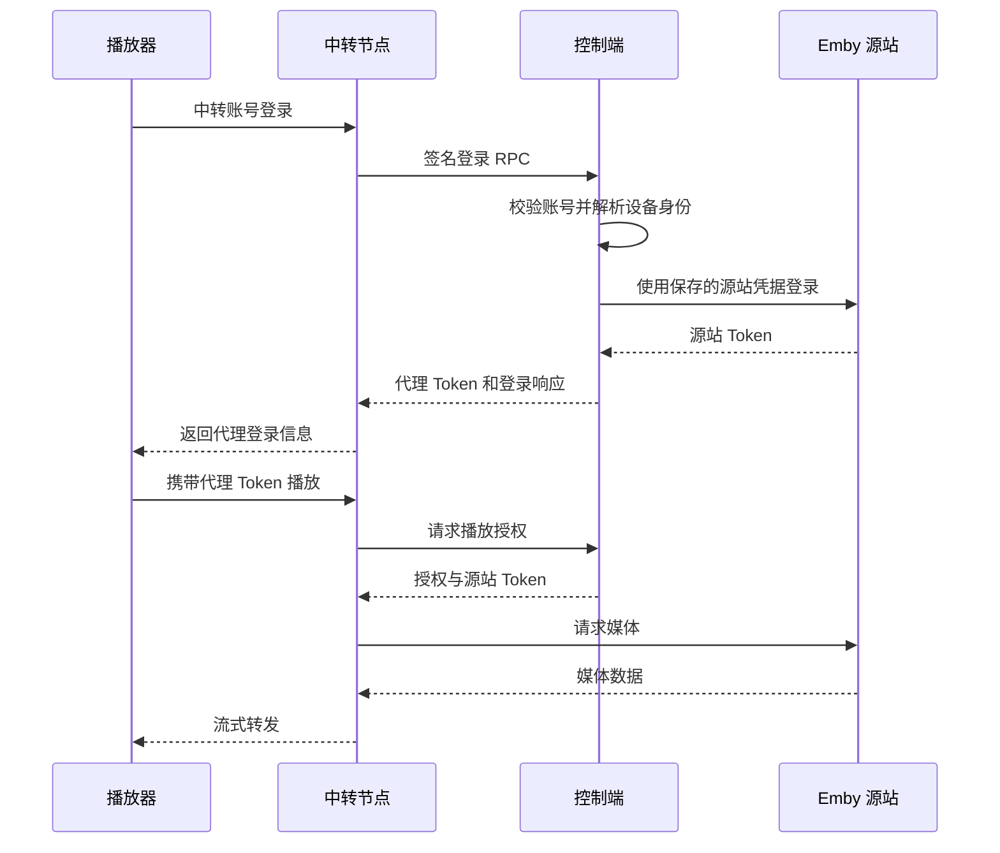

# 安全模型

## 身份

| 项目 | 实现 |
| :--- | :--- |
| 管理员初始化 | 环境变量指定账号，密码 8–72 字节，以 bcrypt 保存 |
| 管理会话 | 随机 192 位，保存 SHA-256 摘要，12 小时有效 |
| Cookie | HttpOnly、SameSite=Strict；生产默认 Secure |
| 写管理 API | 要求 `X-Requested-With: EmbyRelay`，拒绝不匹配的 Origin 和跨站请求 |
| 登录与注册限速 | 直接 TCP 来源每五分钟 10 次；同一反代后的请求共享来源限额 |
| 只读操作员 | 允许读取管理信息 |
| TOTP | 密码复验、6 位动态码、前后一个时间窗口；安全设置变更撤销会话 |
| 密码变更 | 撤销现有登录会话 |
| 播放密钥 | 随机 192 位，以摘要鉴权；历史访问地址加密保存供管理员查看 |
| 密钥撤销与过期 | 拒绝新请求 |
| 回源字段 | 清除管理员 Cookie、代理密钥头、Referer 和伪造转发头；Emby 认证由源站处理 |

## 网络边界

媒体自动跟随 HTTP/HTTPS 跳转，不审批域名，也不拒绝 HTTPS→HTTP。保留私网 CIDR 校验、跳转次数限制和跨域认证头清理。普通 API 的跨源跳转仍被拒绝。DNS 结果与实际拨号 IP 均受网络策略校验。

白名单意味着管理员授予网络访问权限。不要加入 `0.0.0.0/0`、`::/0` 或宽泛内网段。节点 endpoint 由一次性注册令牌持有人提供，因此注册令牌只交给可信节点管理员。

媒体跳转由服务端跟随并转发，跨源跳转移除认证与设备身份头。媒体目标继续接受网络策略校验与流量计量。

## Agent

注册令牌十分钟过期、单次消费。Agent 生成 Ed25519 身份，每次请求签名包含方法、完整路径、时间戳、随机 nonce 和请求体摘要；控制端允许 ±120 秒时间差，并持久化 nonce 防重放。生产使用验证证书的 HTTPS；不设置 InsecureSkipVerify。

服务器对配置签名，Agent 验证签名、配置版本与新鲜时间。本地缓存使用 AES-GCM 加密，过期停止服务。私钥/master.key/身份文件和数据库都必须随备份保护，目录不得挂载给其他不可信容器。

离线缓存与立即撤销存在明确取舍：控制面离线时可以继续使用旧配置最多 24 小时；停用节点、撤销密钥不会立即到达离线节点。需要即时吊销时，运营方应在防火墙或入口负载均衡层隔离节点。

## 日志与资源

服务日志不记录完整请求 URL、Token 或带签名的跳转 URL；项目 Nginx 模板关闭访问日志。审计仅存 actor/action/对象 ID，管理登录失败不存密码。数据库失败时流量计量与配额失败关闭。

请求头上限 32 KiB、请求头超时 10 秒、客户端上传上限 32 MiB、路由并发控制、有界媒体缓冲、读写超时。应用层计量不包含网络包开销。不要把本地开发的 `RELAY_ALLOW_INSECURE=true` 用在公网入口。

Emby 导入账号及密码使用 AES-GCM 加密保存，仅管理员主动查看接口可解密返回，响应禁止缓存，并记录不含凭据的审计事件。凭据不下发 Agent。

## 独立订阅登录

中转访问密码仅保存 bcrypt 哈希；真实 Emby 凭据及源站 Token、受保护媒体目标 URL 用主密钥加密保存。代理 Token 只保存摘要，并绑定账号；媒体地址同时绑定账号和代理 Token。禁止绑定返回 IsAdministrator=true 的源站用户。普通地址仍采用原来的源站登录方式，不具备订阅隔离能力。

源站登录不跟随跳转，源站密码不进入 Agent 配置。节点播放时持有源站 Token，因此仅部署受信任节点。多个代理账号共用真实账号时，共享源站观看数据与权限。

到期、停用与撤销在请求和周期检查中执行；网络故障拒绝继续授权。额度在输出前按块预扣，断线可能多计最后预扣块。媒体目标保护覆盖 JSON 中已识别的媒体地址字段与 HLS 播放列表。

用户中心使用独立 Cookie 和独立接口，不能访问管理端 API。自助源站归属由服务端设置，变更和删除均核对当前账号；不接受用户传入配额、所有者、节点或私网例外。自助源站回源继续使用 DNS 与实际拨号 IP 校验，默认仅允许公网。播放 Token 绑定具体访问密钥，防止同一用户多个源站之间串用 Token；源站修改或删除时撤销相关 Token。用户中心会话不激活首次播放订阅，到期后可查看账户信息，停用后拒绝登录。

订阅额度使用双向折算：charge.bytes 仍传实际输出块大小，由控制端统一按 2 倍扣减 access_usage；限速按原始 bytes 计算。旧用量不追溯翻倍，普通路由上下行统计不变。该规则为成本折算，不等于厂商网卡账单。
