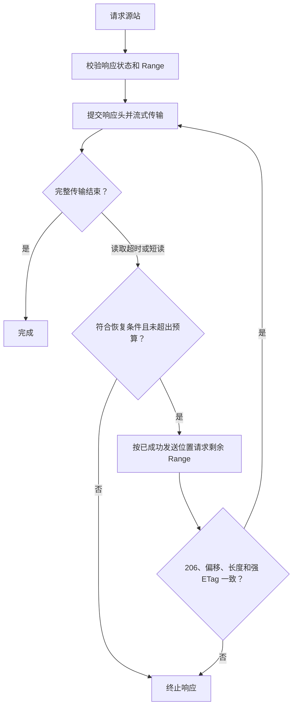

# 流媒体转发

GET 视频和音频 `stream`/`stream.*` 入口使用专用媒体引擎，其他请求（含 POST、HEAD、多范围和 WebSocket）使用 ReverseProxy。播放路径大小写匹配支持 `/Videos`、`/Audio` 和 `/emby` 前缀。

## 协议

- Range 被上游忽略时保留 200，并转发完整响应，不把它伪装为 206。
- 206 必须有合法 Content-Range，必须与原始单范围请求起止位置一致；支持开放范围与后缀范围。已知 Content-Length 必须匹配区间长度。
- 416 和其 Content-Range 原样转发。
- 多范围请求由普通代理转发，不参与字节续拉。
- 不自动压缩媒体，发送 `Accept-Encoding: identity`。
- 客户端取消沿 context 传播；256 KiB 上游读取缓冲与同步写出形成有界背压，不创建无限媒体队列。

## 恢复状态

| 恢复条件 | 校验 |
| :--- | :--- |
| 资源 | 已知完整长度、无内容编码、非 multipart、存在强 ETag |
| 位置 | `next` 只累计成功写给客户端的字节 |
| 请求 | 剩余 Range 与 If-Range |
| 响应 | 206；起止位置、总长度、强 ETag 和内容长度均一致 |
| 异常 | 返回 200、偏移或版本变化时终止，避免拼接错误内容 |

已提交响应头后，通过 `http.ErrAbortHandler` 终止连接或流。无强 ETag 的资源可正常播放，但不自动续拉。

## 默认预算

| 项目 | 默认 |
|---|---|
| TCP / TLS 握手 | 各 5 秒 |
| 响应头 | 15 秒 |
| 上游媒体单次阻塞读取 | 30 秒 |
| 下游单次写入 | 30 秒 |
| 客户端请求体单次读取 | 30 秒 |
| 普通请求体上限 | 32 MiB |
| 每次媒体请求初始/恢复握手 | 最多 3 次，针对传输错误或 502/503/504 |
| 总续拉次数 | 32 |
| 滚动一分钟续拉 | 8 |
| 连续不足 512 KiB 推进 | 最多 3 次 |
| 媒体缓冲 | 256 KiB |

媒体读取超时只取消当前上游请求，符合条件时可以续拉；慢下游等待不计入上游读取失活时间。只有媒体 GET 使用应用层重试。登录 POST 和其他副作用请求不重试。

## 重定向

媒体跳转最多跟随 6 次，自动接受 HTTP/HTTPS 目标，允许 HTTPS→HTTP。每次跳转校验目标 IP；跨源时清理敏感认证头。统一由服务器中转，旧模式不再决定直连行为。

API 的同源跳转改写为代理路径；跨源 API 跳转拒绝。JSON 中 DirectStreamUrl、TranscodingUrl、DeliveryUrl、ServerAddress、LocalAddress、WanAddress 的同源绝对 URL 或根路径会改写为代理路径。只对最多 8 MiB JSON 进行改写；更大响应保持原样流式传输。Set-Cookie 的 Domain 移除、Path 限定在代理前缀。
